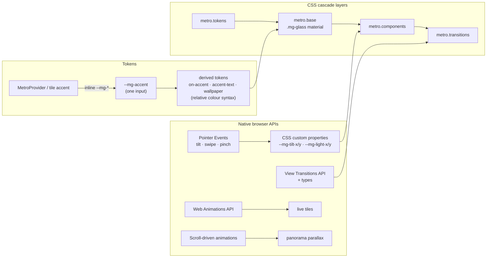

# metro glass

A React UI library that blends **Metro UI** (Windows 8 / Windows Phone) with Apple's **Liquid Glass**:
Metro's typographic grid, live tiles and kinetic motion, rendered in a translucent, light-reactive material.

```bash
npm install metro-glass
```

```tsx
import { MetroProvider, Page, TileGrid, TileGroup, Tile } from 'metro-glass';
import 'metro-glass/styles.css';

<MetroProvider accent="cobalt" shape="blend" theme="system">
  <Page>
    <TileGrid aria-label="Start" semanticZoom>
      <TileGroup title="Life at a glance">
        <Tile size="wide" title="Weather" accent="cyan">…</Tile>
        <Tile title="Mail" badge={5} onClick={openMail} />
      </TileGroup>
    </TileGrid>
  </Page>
</MetroProvider>;
```

## Components

| Component | Notes |
| --- | --- |
| `Tile` | small / medium / wide / large; accent or glass; photo tiles; live tiles (flip, peek, fade) via the Web Animations API; tilt-on-press; renders `<a>`, `<button>` or `<div>` |
| `Button` | accent / glass / outline / subtle; rect / pill / circle (Metro app bar) |
| `Heading`, `Subheading` | semantic level decoupled from visual size; Metro lowercase; caps eyebrow |
| `Tabs` (`TabList`, `Tab`, `TabPanel`) | Metro pivot or glass segmented control; WAI-ARIA tabs; swipe; animated indicator |
| `Link` | inline / standalone / nav; external links; `onNavigate` for client-side routing inside a view transition |
| `Page`, `Stack`, `TileGrid`, `TileGroup`, `Hub`, `HubSection` | page surface, flex stack, start screen with semantic zoom, panorama with scroll-driven parallax |
| `PageTransition` + `useViewTransition` | turnstile, continuum, slide, fade, shared-element morphs |
| `MetroProvider` | scoped tokens: accent, theme, shape, any `--mg-*` value |

Hooks are exported too: `usePressTilt`, `useSwipe`, `usePinch`, `useReducedMotion`, `useViewTransition`.

## Architecture



- **No CSS-in-JS, no runtime styling.** Components write `data-*` attributes and a handful of custom properties; CSS does the rest.
- **Cascade layers** (`metro.tokens → metro.base → metro.components → metro.transitions`): any unlayered CSS you write beats the library without specificity games.
- **One accent in, a whole palette out.** Derived colours are computed with relative colour syntax (`oklch(from var(--mg-accent) …)`). Text on accent flips between black and white automatically for contrast (`--mg-contrast-threshold`).
- **Modern CSS used:** nesting, `@layer`, `@property` (animated tilt and light), `light-dark()`, relative colours, container queries (+ `cqi`), `@starting-style`, `view-transition-class`, `:active-view-transition-type()`, scroll-driven animations, `zoom`, `linear()` spring easing.

## Tokens

All tokens are `--mg-*` custom properties (see [`src/styles/tokens.css`](src/styles/tokens.css)). Set them in CSS or through the provider:

```tsx
<MetroProvider accent="#ff4f00" shape="glass" glassBlur="30px" glassTint={0.7} tileUnit="88px">
```

`shape` presets: `metro` (square), `blend` (default), `glass` (round). The 20 classic Windows 8 accents are available by name (`lime`, `cobalt`, `magenta`, …) via `metroAccents`.

## Motion & transitions

```tsx
const transition = useViewTransition();
transition(() => setRoute('/settings'), { types: ['turnstile'] });

<PageTransition>{route === 'home' ? <Home /> : <Settings />}</PageTransition>
```

Give a `Tile` and a `Heading` the same `transitionName` for a continuum morph. Multi-page apps can `import 'metro-glass/navigation.css'` for cross-document transitions.

## Multi-touch

- Every tile tracks its own pointers: several tiles can be pressed and tilted at once, and a tile stays pressed until every finger on it lifts.
- `Tabs` panels switch on a horizontal swipe (`touch-action: pan-y` keeps vertical scrolling native).
- `TileGrid semanticZoom`: pinch in/out with two fingers, or ctrl + scroll on a trackpad.

## Accessibility

- WAI-ARIA tabs pattern with roving tabindex, ←/→/Home/End (RTL aware), automatic or manual activation.
- Semantic levels are separate from visual sizes; lowercase is CSS-only, so screen readers read the original text.
- Live tiles pause on hover and focus, and stop with `prefers-reduced-motion` or `paused`.
- Semantic zoom has a non-gesture path (controlled `zoomed` prop; zoomed-out groups are buttons; tiles become `inert`).
- Honours `prefers-reduced-motion`, `prefers-reduced-transparency`, `prefers-contrast: more` and `forced-colors`.
- 44px minimum touch targets on coarse pointers; visible `:focus-visible` rings.
- axe-core runs in the unit tests and in Storybook (`@storybook/addon-a11y`, violations fail).

**Known trade-off:** glass is translucent, so real contrast depends on what sits behind it. Accent tiles use a high tint (`--mg-glass-tint: 0.82`) and a contrast-aware text colour; lower the tint only over backgrounds you control.

## Browser support

Targets evergreen browsers (Chrome/Edge 123+, Firefox 128+, Safari 18+). Progressive enhancement where support is still landing:
view transitions fall back to instant updates, scroll-driven parallax is skipped without `animation-timeline`, and live tiles swap without animation where the Web Animations API is missing.

## Development

```bash
npm run dev              # Storybook on :6006
npm test                 # Vitest + Testing Library + axe
npm run typecheck
npm run build            # dist/: ESM + .d.ts + metro-glass.css + navigation.css
npm run build-storybook
npm run dev:demo         # demo app on :5173
npm run build:site       # demo → site/, Storybook → site/storybook/
```

## Hosting (Cloudflare Workers)

The demo and Storybook are served at **https://mg.oss.messmer.de.com** by the assets-only `metro-glass` Worker ([`wrangler.jsonc`](wrangler.jsonc)):

| Path | Content |
| --- | --- |
| `/` | demo app (SPA; unknown paths fall back to `index.html`) |
| `/storybook/` | Storybook |

Deploys run through **Cloudflare Workers Builds**, connected to this repository: pushes to `main` run
`npm run build:site` and `npx wrangler deploy`; other branches upload a preview version
(`npx wrangler versions upload`) with its own preview URL. Manual deploy: `npm run deploy`.
